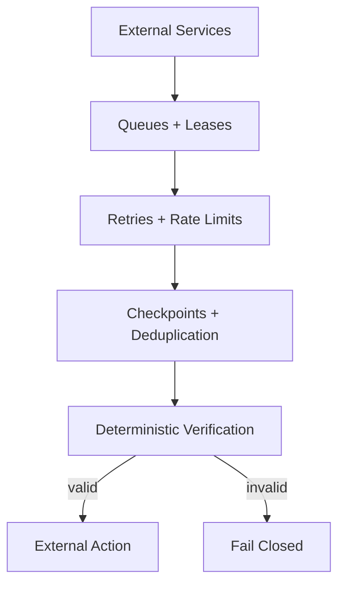

> [!IMPORTANT]
> **A note to recruiters:** If you somehow ended up here, hello. HO [Hyperdimensional Orchestrator] is a job-discovery engine: it finds, verifies, and archives real postings from across the internet. If your posting is in here, congratulations your ATS has officially become part of my distributed systems experiment.

 

  

 

## Introduction

HO (Hyperdimensional Orchestrator) is a job-discovery engine built because existing job platforms are fundamentally static: they search a limited set of sources, rank with fixed rules, and show largely generic results.

HO runs 24/7 as two apps. The **ingest service** discovers postings across the entire internet (ATS APIs, job boards, free JSON firehoses, search engines), verifies each one is a real posting, normalizes and embeds it, and enriches it with founder/funding intel — building one large corpus across every role, level, and function, from junior to staff, engineering to design. The **web app** (in progress) turns that corpus into personalized matching: account, persona onboarding, and a chat agent.

The goal is not a bigger scrape. It is a corpus you can trust: every row is either proven real (structured ATS APIs, decision-model judgments) or explicitly marked unverified — never silently faked, never silently dropped.

## Performance

HO runs as a continuous stream pipeline (Redis Streams between stages), not batch sweeps. Measured on 2 local processes over 2-minute windows:

| What | Observed |
| --- | --- |
| Observations ingested | **~640 / min** (dedup-filtered net adds) |
| Discovery firehose | **9,000+ URLs / 4 s** bursts + bulk board imports |
| Verified share | ATS-direct JSON, Workday CXS, SubQ judgments; rest tiered unverified |
| Embeddings | Gemini 3072-d, batched, content-hash deduped |
| Founders / funding | parsed from search evidence, cached 7d, graphed |

End-to-end rate is consumer-bound (fetch renders, verification judgments), never discovery-bound. Backpressure is explicit: capped streams, BLOCK reads, persistent dedup, DLQ for poison messages.

# System Architecture

Two apps, one corpus. The ingest service builds it; the web app (and its Prisma contract in `packages/db`) reads it. Everything below is the ingest half — the part that runs 24/7.

The important architectural properties:

- **Continuous, not batched.** Stages run forever as Redis-Streams consumer groups. No sweeps, no phases, no global barriers.
- **Tiered trust.** Rows are `verified` (ATS APIs, decision-model judgments) or `unverified` (real-looking, unproven). Unverifiable is not fake — but only verified rows are claimed as such.
- **Postgres is the record store; Redis is motion; Neo4j is intel.** Streams carry tiny routing payloads; bodies live in Postgres.

## 1. Discovery (11 producer types, always on)

ATS-direct JSON (Greenhouse/Lever/Ashby), Workday CXS bulk import, ATS board polls, high-volume URL discovery, mass slug poller, GitHub indexes, SearXNG dorks, TinyFish web search (12k/day), free JSON firehoses (Arbeitnow, RemoteOK, HN hiring threads, USAJobs), and company discovery. Interval-guarded per source, persistently deduped (Redis, 7d TTL), backpressured by stream caps.

## 2. Fetch (24 workers/proc)

ATS URLs take the sub-second JSON path (verified by construction). Everything else renders locally, with TinyFish Fetch as the off-box fallback for JS shells. Scraped bodies are archived into the observation row; already- persisted structured rows are never re-rendered. Unfetchable leaf URLs (auth-walled LinkedIn views, Indeed search pages, JS wrappers) are filtered at publish so they never burn fetch budget.

## 3. Normalize (16 workers/proc)

Deterministic gates only: URL quality, duplicates, role classification (never rejects — every role/level/function enters), freshness lanes (stale rows are archived, not rejected). ATS rows arrive verified; the rest get a SubQ `systemone` real-posting judgment (cached by content hash, 30/min cap, 402 breaker). Pass or fail, substantive rows enter tiered; thin garbage dies.

## 4. Embed + Enrich

Embeddings (Gemini 3072-d, batched, content-hash deduped) land in pgvector. Enrichment attaches founders/funding parsed from search evidence (cached 7d in `company_osint`) onto candidate rows and Neo4j (`FOUNDED_BY`, `HAS_FUNDING`), so the graph grows relations again.

```mermaid
flowchart TD

HO["<b>HO · CONTINUOUS JOB CORPUS PIPELINE</b><br/><br/>11 PRODUCERS → STREAMS → STAGES → CORPUS, FOREVER<br/><br/>No sweeps · No phases · Tiered trust · Every crash redelivers"]

%% ============================================================
%% INFRASTRUCTURE
%% ============================================================

subgraph INFRA["LOCAL + PROD INFRA · DOCKER"]
direction TB

subgraph DOCKER["Compose / Dokploy"]
direction LR

SEARXNG["<b>SearXNG</b> :8080<br/>Meta-search aggregation<br/>Dork queries across ATS boards"]

TOR["<b>Tor SOCKS5</b><br/>Rotating exits + country pinning<br/>Geo-aware render routing"]

PG["<b>PostgreSQL + pgvector</b> :5443<br/><br/>job_observations · radar_candidates<br/>obs_embeddings · source_checkpoints<br/>company_osint · evidence · decision_events"]

REDIS["<b>Redis</b> :6380<br/><br/>Streams (motion) · dedup sets 7d<br/>Budgets · verdict cache<br/>requirepass · maxmemory LRU"]

NEO["<b>Neo4j</b> :7687<br/><br/>Company · Founder nodes<br/>FOUNDED_BY · HAS_FUNDING edges"]

OO["<b>OpenObserve Enterprise</b> :5090<br/><br/>OTLP logs + traces<br/>Dashboards · DLQ alerts"]

end

end

%% ============================================================
%% PRODUCERS (11, always on, interval-guarded)
%% ============================================================

subgraph PRODUCERS["01 · DISCOVER PRODUCERS · CONCURRENT TICKS"]
direction TB

HV["<b>High-Volume Discovery</b><br/>github + ATS mass + searxng + YC<br/>4s box · ~9k URLs per burst"]

MASS["<b>Mass ATS Poller</b><br/>3 platform tasks · sem30<br/>every 120s"]

GHIDX["<b>GitHub Indexes</b><br/>ETag polling<br/>every 60s"]

DORK["<b>SearXNG Dorks</b><br/>66 queries: 12 ATS sites ×<br/>seniority + function slices<br/>every 60s · 20s box"]

TFSEARCH["<b>TinyFish Search</b><br/>120 rotating queries<br/>roles × levels × geos<br/>12k/day cap · freshness window"]

BOARD["<b>Board Poll</b><br/>ATS interceptor API first<br/>Workday CXS bulk import<br/>browser re-map when stale<br/>40 boards/tick · sem24"]

COMPANY["<b>Company Discovery</b><br/>Common Crawl + Dealroom<br/>YC · VC · HN · RemoteOK<br/>every 30min"]

FREE["<b>Free JSON Firehoses</b><br/>Arbeitnow · RemoteOK tags<br/>HN hiring threads · USAJobs<br/>structured · verified at source"]

end

%% ============================================================
%% STREAMS
%% ============================================================

subgraph STREAMS["02 · REDIS STREAMS · MOTION, NOT STATE"]
direction TB

SD["<b>ho:s:discover</b><br/>{url, source}"]
SR["<b>ho:s:raw</b><br/>{url_hash, url}"]
SG["<b>ho:s:gated</b><br/>{canonical_id}"]
SE["<b>ho:s:embed</b><br/>{url_hash}"]
SN["<b>ho:s:enrich</b><br/>{company}"]
DLQ["<b>ho:s:dlq</b><br/>Poison messages"]

CAP["<b>MAXLEN caps + BLOCK reads</b><br/>Backpressure, no hot spin<br/>Consumer groups per stage<br/>PEL + autoclaim reap"]

end

%% ============================================================
%% FETCH
%% ============================================================

subgraph FETCH["03 · FETCH ×24 · FASTEST PROOF FIRST"]
direction TB

ATSAPI["<b>ATS-Direct JSON</b><br/>Greenhouse boards-api<br/>Lever postings API<br/>Sub-second · verified by construction"]

WORKDAYSTRUCT["<b>Structured Passthrough</b><br/>Interceptor + Workday rows<br/>already carry content<br/>Persist, never re-render"]

RENDER["<b>Render Chain</b><br/>Static httpx first<br/>TinyFish Fetch for JS shells<br/>Local browser last resort"]

UNFETCH["<b>Unfetchable Filter</b><br/>LinkedIn views · Indeed search<br/>JS wrappers dropped at publish<br/>Never burn fetch budget"]

ARCHIVE["<b>Markdown Archive</b><br/>Page text → raw_json<br/>Corpus keeps JD bodies"]

end

%% ============================================================
%% NORMALIZE
%% ============================================================

subgraph NORMALIZE["04 · NORMALIZE ×16 · DETERMINISTIC GATES"]
direction TB

GATES["<b>Gates (never reject roles)</b><br/>URL quality · duplicates<br/>Role classification<br/>Freshness lanes (stale = archive)"]

SUBQ["<b>SubQ systemone Verify</b><br/>subq-snap-preview · prefill-priced<br/>P(real posting) ≥ 0.7<br/>Verdict cache · 30/min cap · 402 breaker"]

TIER["<b>Tier, Don't Execute</b><br/>verified → corpus as verified<br/>unverified + substantive → corpus as unverified<br/>Only dupes + garbage reject"]

end

%% ============================================================
%% EMBED + ENRICH
%% ============================================================

subgraph EMBED["05 · EMBED ×4"]
direction TB

BATCH["<b>Batched Vectors</b><br/>Gemini 3072-d · batch 32<br/>Content-hash dedupe<br/>Missing-hash backfill"]

end

subgraph ENRICH["06 · ENRICH ×2"]
direction TB

EVIDENCE["<b>Search Evidence</b><br/>TinyFish founders + funding<br/>Deterministic parse, no guessing<br/>company_osint cache 7d"]

GRAPHWRITE["<b>Graph Write</b><br/>Founder nodes · FOUNDED_BY<br/>Funding stage · HAS_FUNDING"]

end

%% ============================================================
%% CORPUS + CONTRACT
%% ============================================================

subgraph CORPUS["07 · CORPUS + CONTRACT"]
direction TB

TABLES["<b>Postgres Tables</b><br/>observations · candidates<br/>embeddings · checkpoints<br/>osint · evidence"]

CONTRACT["<b>packages/db · Prisma 8</b><br/>Read-only contract<br/>Emit ok · drift-checked<br/>TypedSQL vector search"]

WEB["<b>Web App (in progress)</b><br/>Account · persona onboarding<br/>Chat agent over the corpus"]

end

%% ============================================================
%% OPS
%% ============================================================

subgraph OPS["08 · OVERNIGHT OPS"]
direction TB

SUPER["<b>Supervisor</b><br/>Unlimited restarts + backoff<br/>Stream-depth status<br/>Hang watchdog"]

HEALTH["<b>/healthz + /readyz :8080</b><br/>Rolling deploys gate on ready<br/>60s stop grace · PEL redelivery"]

DEPLOY["<b>Dokploy / GCE</b><br/>unless-stopped · mem limits<br/>Secrets via env · loopback ports<br/>Backups + monitor --check"]

end

%% ============================================================
%% NOTES
%% ============================================================

NOTE_TRUST["<b>TRUST NOTE</b><br/>Unverifiable is not fake.<br/>Only verified rows are claimed<br/>as verified; the rest carry<br/>their tier honestly."]

NOTE_SCALE["<b>SCALE NOTE</b><br/>Producers outrun consumers<br/>by design; MAXLEN caps<br/>bound the backlog while<br/>dedup makes replays cheap."]

NOTE_DEPLOY["<b>DEPLOY NOTE</b><br/>Every write idempotent.<br/>Groups + checkpoints +<br/>caches all reload on boot.<br/>Killing a container loses<br/>only in-flight items."]

%% ============================================================
%% CONNECTIONS
%% ============================================================

SEARXNG --> DORK
TOR --> RENDER
PG --> NORMALIZE
REDIS --> STREAMS
NEO --> GRAPHWRITE
OO --> SUPER

HV --> SD
MASS --> SD
GHIDX --> SD
DORK --> SD
TFSEARCH --> SD
BOARD --> SD
BOARD --> WORKDAYSTRUCT
COMPANY --> BOARD
FREE --> SD

SD --> ATSAPI
SD --> RENDER
ATSAPI --> ARCHIVE
RENDER --> UNFETCH
RENDER --> ARCHIVE
ARCHIVE --> SR

SR --> GATES
GATES --> SUBQ
SUBQ --> TIER
TIER --> SG
TIER --> SE
TIER --> SN
TIER --> DLQ
STREAMS ~~~ CAP

SE --> BATCH
BATCH --> TABLES
SN --> EVIDENCE
EVIDENCE --> GRAPHWRITE
GRAPHWRITE --> NEO

TABLES --> CONTRACT
CONTRACT --> WEB

SUPER --> HEALTH
HEALTH --> DEPLOY

INFRA ~~~ NOTE_TRUST
STREAMS ~~~ NOTE_SCALE
OPS ~~~ NOTE_DEPLOY

%% ============================================================
%% STYLES
%% ============================================================

classDef rootNode fill:#111827,color:#ffffff,stroke:#60a5fa,stroke-width:3px

classDef infraNode fill:#0f172a,color:#e2e8f0,stroke:#64748b
classDef discoveryNode fill:#172554,color:#dbeafe,stroke:#3b82f6
classDef streamNode fill:#164e63,color:#cffafe,stroke:#22d3ee
classDef fetchNode fill:#052e16,color:#dcfce7,stroke:#22c55e
classDef decisionNode fill:#14532d,color:#dcfce7,stroke:#4ade80
classDef embedNode fill:#4a044e,color:#fae8ff,stroke:#d946ef
classDef enrichNode fill:#451a03,color:#fef3c7,stroke:#f59e0b
classDef corpusNode fill:#1e1b4b,color:#e0e7ff,stroke:#a78bfa
classDef opsNode fill:#431407,color:#ffedd5,stroke:#fb923c
classDef noteNode fill:#f8fafc,color:#111827,stroke:#94a3b8,stroke-dasharray:5 5

class HO rootNode

class SEARXNG,TOR,PG,REDIS,NEO,OO infraNode

class HV,MASS,GHIDX,DORK,TFSEARCH,BOARD,COMPANY,FREE discoveryNode

class SD,SR,SG,SE,SN,DLQ,CAP streamNode

class ATSAPI,WORKDAYSTRUCT,RENDER,UNFETCH,ARCHIVE fetchNode

class GATES,SUBQ,TIER decisionNode

class BATCH embedNode

class EVIDENCE,GRAPHWRITE enrichNode

class TABLES,CONTRACT,WEB corpusNode

class SUPER,HEALTH,DEPLOY opsNode

class NOTE_TRUST,NOTE_SCALE,NOTE_DEPLOY noteNode
```

Postgres holds every record (observations, candidates, embeddings, checkpoints). Redis holds motion (streams, dedup, budgets) and is safe to lose. Neo4j holds derived company intel and rebuilds from the corpus.

## 5. Engineering Principles, Reliability & Roadmap

HO is designed around a few core engineering constraints: PostgreSQL remains the transactional source of truth, pgvector provides semantic retrieval without another vector database, Neo4j handles relationship-heavy intelligence, and Redis Streams carry motion between stages that never block each other. Every write is idempotent, every queue is bounded, every crash redelivers — so killing a container mid-run (deploys do this on every merge) loses nothing.

External systems are treated as unreliable dependencies. Search sources can disappear, ATS schemas can change, HTTP requests can be blocked, browser sessions can fail, model APIs can 429 or run dry. The system therefore uses retries, per-source rate limits and daily budgets, checkpoints, persistent dedup, verdict caching, fallback acquisition paths, and a DLQ for poison messages. An unprocessed URL is preferable to a fabricated job.

The long-term direction is corpus depth and trust: more sources, more functions and geos, richer company intel, and tighter verification — feeding the web app's matching. The fundamental objective remains the same: a job corpus comprehensive enough and honest enough to recommend from.

## Final Notes

HO is intentionally overengineered for its original purpose. That is part of the point. It started as a single-person job-search automaton and evolved into a multi-user discovery platform: a 24/7 corpus service plus a matching web app.

The system is not designed around the assumption that the first version of a source, gate, query strategy, or verification judgment will be correct. Every layer is treated as replaceable and measurable. Sources can be reweighted, gates can be re-cut, budgets can be retuned, and the corpus keeps score of what each producer actually yields.

The most important component is therefore not any individual model or database. It is the pipeline that never stops and never lies about what it found.

**Discover. Verify. Repeat.**

> [!NOTE]
> HO is an engineering experiment built around a very simple premise: a job is only real if you can prove it.

---

## Credits

Built, designed, debugged, over-engineered, and occasionally questioned at unreasonable hours by [pzk](https://przknv.cc).

The architecture borrows ideas from distributed systems, information retrieval, stream processing, graph analytics, retrieval-augmented generation, browser automation, and event-driven systems.

The project also owes an unreasonable amount to the scientific methodology of one self-proclaimed mad scientist.

> “The world is not deterministic. We merely haven't collected enough observations yet.”

~ **El. Psy. Kongroo.**
